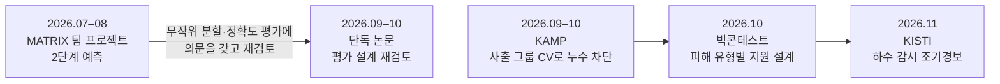

# 프로젝트 포트폴리오 — 전건우

백엔드 엔지니어를 지향하는 컴퓨터공학 전공생의 프로젝트 모음입니다.
Python·SQL로 흩어진 데이터를 연결해 반복 실행 가능한 파이프라인을 만들고,
**데이터가 만들어지는 단위와 예외를 먼저 확인한 뒤 같은 입력에서 같은 결과가 나오는지 검증**해 왔습니다.
프로젝트마다 저장소가 따로 있고, 각 README만 읽어도 문제·방법·결과·한계를 파악할 수 있도록 정리했습니다.

| 프로젝트 | 한 줄 요약 | 핵심 결과 | 저장소 |
|---|---|---|---|
| **하수 감시 감염병 조기예측** 2026 DATA·AI 분석 경진대회 (KISTI) · 개인 · 2026.11 | 시·도 하수 농도를 전국 공통 유행파 + 지역 편차로 분해해 2주 뒤 농도·급증 경보 예측 | 정량점수 0.2212 → **0.3005**, 10개 평가 창 모두 기준 모델보다 높음 | [kowas-wastewater-early-warning](https://github.com/j2tori-design/kowas-wastewater-early-warning) |
| **같은 비, 다른 피해** 제14회 빅콘테스트 AI데이터분석 · 개인 · 2026.10 | 카드 매출 285만 행·유동인구·기상·지하철을 결합해 호우 피해 상권을 진단하고 지수형 손실보전 설계 | 춘천 3일 순손실 **−14.6%** (강남의 2배), 매출 감소의 56%는 발길 감소, 지급액-실손 상관 0.74 | [bigcontest-2026-rain-damage](https://github.com/j2tori-design/bigcontest-2026-rain-damage) |
| **사출성형 불량 예측과 검사 우선순위** 제6회 KAMP 제조AI 경진대회 · 개인 · 2026.09–10 | 데이터에 없는 2-캐비티 사출 구조를 복원하고 그룹 CV로 누수 차단, 위험점수로 검사 순서 결정 | 행 단위 평가 과대평가 **52%** 차단, 상위 20% 검사로 CN7 불량 12/13건 포착 | [kamp-injection-defect-prediction](https://github.com/j2tori-design/kamp-injection-defect-prediction) |
| **안락사 예측의 평가 설계 재검토** 한국정보기술학회 추계 학술대회 투고 · 단독 저자 · 2026.09–10 | 같은 데이터에서 평가 방식에 따라 보고 성능이 달라지는 원인을 누수·판정 방식·평가 기간으로 분해 | 무작위 평가가 운영 성능을 **약 2배** 부풀림, 성별 'Unknown' 누수 발견 | [shelter-euthanasia-evaluation](https://github.com/j2tori-design/shelter-euthanasia-evaluation) |
| **보호소 운영 우선순위 2단계 예측** 교내 AI 학회 MATRIX 컨퍼런스 · 팀 조장 · 2026.07–08 | 다중분류를 입양 여부 + 비입양군 안락사 위험의 2단계로 재정의하고 개입 우선순위 점수 제안 | 안락사 모델 Recall 0.817 · PR-AUC 0.777, **참가 10팀 중 최우수상** | [animal-shelter-matrix](https://github.com/j2tori-design/animal-shelter-matrix) |

## 프로젝트를 관통하는 질문

- **평가를 먼저 의심한다:** 같은 모델도 평가 단위(행 vs 사출 그룹), 평가 기간(무작위 vs 미래), 판정 방식(최대 확률 vs 위험 순위)에 따라 성능이 크게 달라진다는 것을 매 프로젝트에서 수치로 확인했습니다.
- **예측을 결정으로 잇는다:** 검사 순서(KAMP), 개입 우선순위(MATRIX·논문), 지원 대상과 지급액(빅콘테스트), 조기경보(KISTI)처럼 현장에서 쓸 형태로 결과를 냈습니다.
- **한계를 숫자로 밝힌다:** 단순 규칙보다 낫다고 확인되지 않은 결과, 검증할 수 없는 조건, 넣지 않은 실험까지 함께 보고했습니다.

## 알고리즘 풀이

자료구조·알고리즘 문제 풀이는 **[Algorithm](https://github.com/j2tori-design/Algorithm)** 저장소에 유형별 폴더, 문제당 파일 하나로 정리했습니다 (그래프 탐색·최단 경로·동적 계획법·백트래킹 등 51개). 각 풀이에는 핵심 아이디어와 헷갈리기 쉬운 지점을 주석으로 적었습니다.

## 데이터 공개 원칙

대회 제공 데이터(신한카드·SK텔레콤·KAMP·KOWAS)는 재배포가 금지되어 있어 **원본·가공본·샘플 모두 저장소에 넣지 않았습니다.** 노트북에서도 원본 행이 보이는 출력은 지웠고, 집계된 결과·그림·보고서와 코드만 공개합니다.

## 기술

Python · SQL · pandas · NumPy · scikit-learn · LightGBM · XGBoost · CatBoost · SHAP · statsmodels · matplotlib · Git/GitHub · Jupyter

---

👤 [전건우 GitHub 프로필](https://github.com/j2tori-design)
